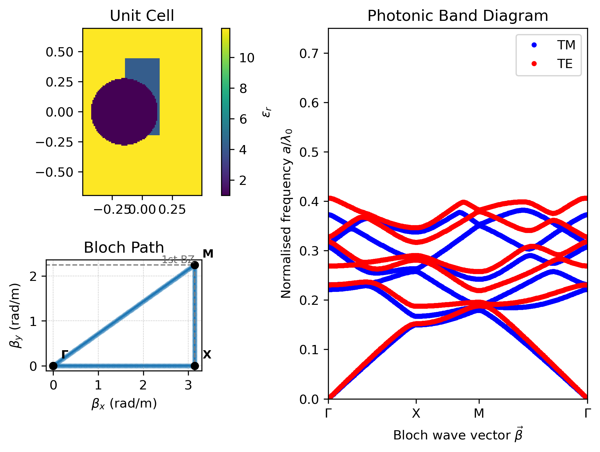

Band structure
==============

:class:`~fdfd.BandStructureSolver2D` computes Bloch eigenfrequencies of a
rectangular cell periodic in x and y. Frequency is the eigenvalue, so the
constructor takes only the cell and background.

Example
-------

.. code-block:: python

   import numpy as np
   import fdfd

   a = 10e-3
   solver = fdfd.BandStructureSolver2D(x_range=(-a / 2, a / 2), y_range=(-a / 2, a / 2))
   solver.add_circle(center=(0, 0), radius=0.2 * a, material=fdfd.Material(name="rod", epsilon=8.9))
   solver.mesh(resolution=(20, 20))
   path = fdfd.bloch_path(((0, 0), (np.pi / a, 0), (np.pi / a, np.pi / a), (0, 0)), num_points=100)
   result = solver.solve(beta_path=path, num_modes=4)
   result.frequencies["TE"]          # (4, 100) array in Hz
   result.normalized_frequencies     # f * a / c

``guess`` is a frequency in hertz: bands nearest to it are returned. With
``guess=None`` the lowest bands are returned; internally the shift is placed
just below the spectrum, which keeps the static :math:`\Gamma`-point mode from
degrading the accuracy of the other bands.

Formulation
-----------

For a Bloch vector :math:`\mathbf k = (k_x, k_y)` the derivative matrices are
periodic forward differences whose wrapped entry carries
:math:`e^{-i k_x L_x}` (or :math:`e^{-i k_y L_y}`); the magnetic-side
operators are their negative adjoints. With diagonal material matrices
sampled at each component's Yee location,

.. math::

   \varepsilon_{zz}^{-1}\left(-D_{hx}\mu_{yy}^{-1}D_{ex} - D_{hy}\mu_{xx}^{-1}D_{ey}\right)E_z
       = \left(\tfrac{\omega}{c}\right)^2 E_z \quad\text{(TM)},

and the dual operator acts on :math:`H_z` for TE. The material inverses are
applied before the eigensolve, so lossy materials need no Hermitian mass
matrix. Frequencies are :math:`f = c\sqrt{\lambda}/2\pi` with the principal
root, giving :math:`\operatorname{Im} f \ge 0` for passive loss.

Materials live on a double-resolution helper grid whose even and odd indices
are cell faces and centres, so each of the six components samples its own
location. ``subpixels`` averages shapes over the half-cell around each sample;
``subpixels=1`` samples the point itself. Only isotropic (scalar) materials
are supported.
