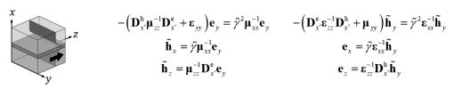

Waveguide modes
===============

:class:`~fdfd.ModeSolver1D` finds TE and TM modes of a slab layered along x;
:class:`~fdfd.ModeSolver2D` finds full-vector modes of an (x, y)
cross-section. Both return a :class:`~fdfd.ModeResult` with modes ordered by
decreasing :math:`\operatorname{Re} n_{\rm eff}`.

Example
-------

.. code-block:: python

   import fdfd
   from fdfd import materials, shapes

   solver = fdfd.ModeSolver2D(frequency=100e9, x_range=(0, 12e-3), y_range=(0, 10e-3))
   wall = shapes.Difference(shape=shapes.Rectangle(bounds=((1.9e-3, 10.1e-3), (1.9e-3, 8.1e-3))),
                            tool=shapes.Rectangle(bounds=((2e-3, 10e-3), (2e-3, 8e-3))))
   solver.add_geometry(shape=wall, material=materials.copper)
   solver.mesh(resolution=(120, 100))
   result = solver.solve(num_modes=4)
   print(result.neff, result.attenuation_constant)   # Np/m from wall loss

See ``examples/waveguide`` for slabs, microstrip, dielectric rods, PML and
frequency sweeps.

Choosing ``guess``
------------------

With ``guess=None`` the shift is placed just above the largest material index
(:math:`1.01\max|\sqrt{\varepsilon_i\mu_j}|` over all principal axes of the
bulk materials), so the fundamental modes are returned first. An explicit
``guess`` targets the modes nearest that effective index, e.g. higher-order or
evanescent modes (``guess=-0.5j``).

Formulation
-----------

Lengths are normalized by :math:`k_0` and the stored magnetic field is
:math:`\tilde H = -i\eta_0 H`. With :math:`\partial_z \to -i\beta`, the
eigenvalue of the reduced transverse operator is
:math:`\lambda = -n_{\rm eff}^2`.

**1D.** With :math:`D_{eh}` mapping node to cell samples and
:math:`D_{he} = -D_{eh}^H` the reverse, and material symbols the diagonal
matrices sampled at each component,

.. math::

   A_{\rm TE} = -\mu_{xx}\left(D_{he}\,\mu_{zz}^{-1} D_{eh} + \varepsilon_{yy}\right),\qquad
   A_{\rm TM} = -\varepsilon_{xx}\left(D_{eh}\,\varepsilon_{zz}^{-1} D_{he} + \mu_{yy}\right)

act on :math:`E_y` and :math:`\tilde H_y`. The other components follow from

.. math::

   \tilde H_x = i n\,\mu_{xx}^{-1}E_y,\quad \tilde H_z = \mu_{zz}^{-1}D_{eh}E_y,\quad
   E_x = i n\,\varepsilon_{xx}^{-1}\tilde H_y,\quad E_z = \varepsilon_{zz}^{-1}D_{he}\tilde H_y .

**2D.** Eliminating :math:`E_z` and :math:`H_z` gives blocks with
:math:`P\,\tilde h_t = i n\,e_t` and :math:`Q\,e_t = i n\,\tilde h_t`, so
:math:`PQ\,e_t = -n^2 e_t` for :math:`e_t = (E_x, E_y)`. Then
:math:`\tilde h_t = Q e_t/(in)`,
:math:`E_z = \varepsilon_{zz}^{-1}(D_{H_y\to E_z}\tilde H_y - D_{H_x\to E_z}\tilde H_x)` and
:math:`\tilde H_z = \mu_{zz}^{-1}(D_{E_y\to H_z}E_y - D_{E_x\to H_z}E_x)`.
At cutoff (:math:`|n| \le 10^{-8}`) the division by :math:`n` is singular:
the eigenpair is kept and its fields are NaN.

**Conductors.** PEC removes the tangential-E samples on and inside the
conductor footprint (and the collocated normal H); PMC is the dual. Inverses
of :math:`\varepsilon_{zz}`, :math:`\mu_{zz}` are taken only on free samples,
and constrained rows and columns are removed before the eigensolve.

**Surface impedance.** Metals (:class:`~fdfd.GoodConductor`, e.g.
``materials.copper``) and :class:`~fdfd.SurfaceImpedance` exclude the
conductor interior and impose :math:`\mathbf E_t = Z_s\,\hat n\times\mathbf H`
on its exposed faces. Each Ampère row touching a face is replaced by its
integral over the retained part of the dual cell: the surface current adds
:math:`L/(i\omega\varepsilon_0 A Z_s)` to the row's permittivity, where
:math:`L` is the exposed face length inside the dual cell of retained area
:math:`A`; corner rows sum the ports of each face. The interface-normal
permeability is sampled from the retained cell only. The result does not
depend on the opaque wall thickness; impedance faces may not touch a PEC/PMC
constraint or the PML.

**Fields and checks.** Constrained samples are set to zero and each mode is
rotated so its fields are as real as possible. ``info.residuals`` holds the
eigenpair backward errors and ``info.field_residuals`` the residual of the
reconstructed field equations (used by the tracker).
``metadata["boundaries"]`` records which outer edges are closed by
conductors.

Accuracy
--------

``benchmarks/analytical/rectangular_waveguide_modes.py`` compares the TE10
mode of a PEC guide against theory; the error converges at second order.
The tests compare copper wall loss with first-order perturbation theory
within 1%.
